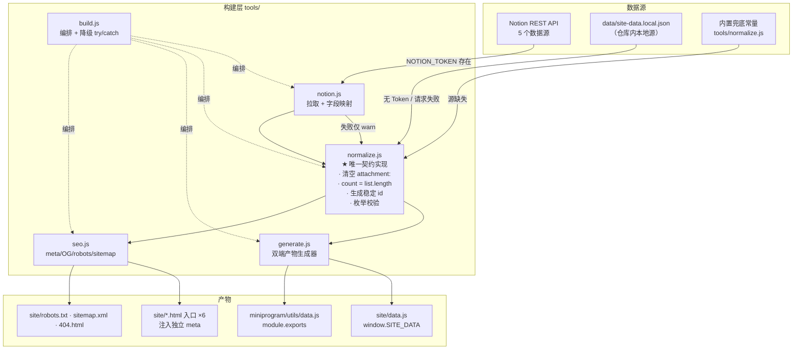
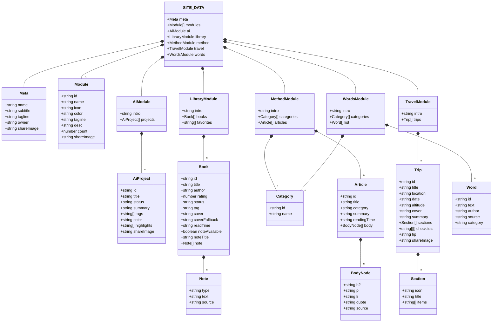
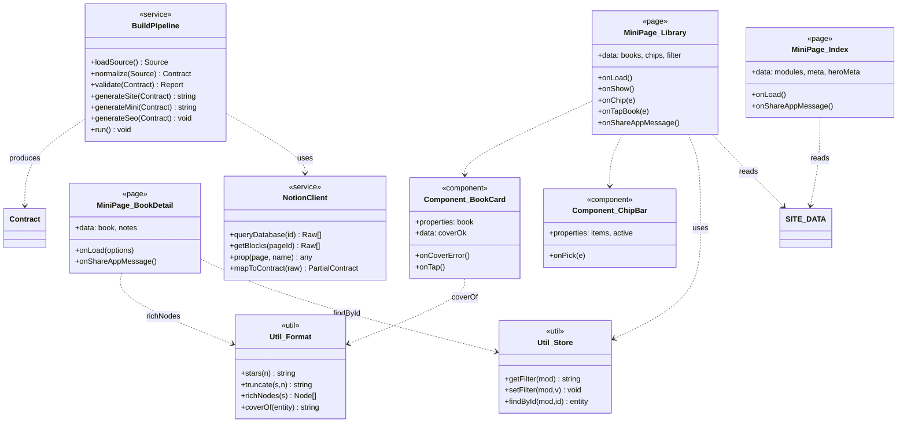
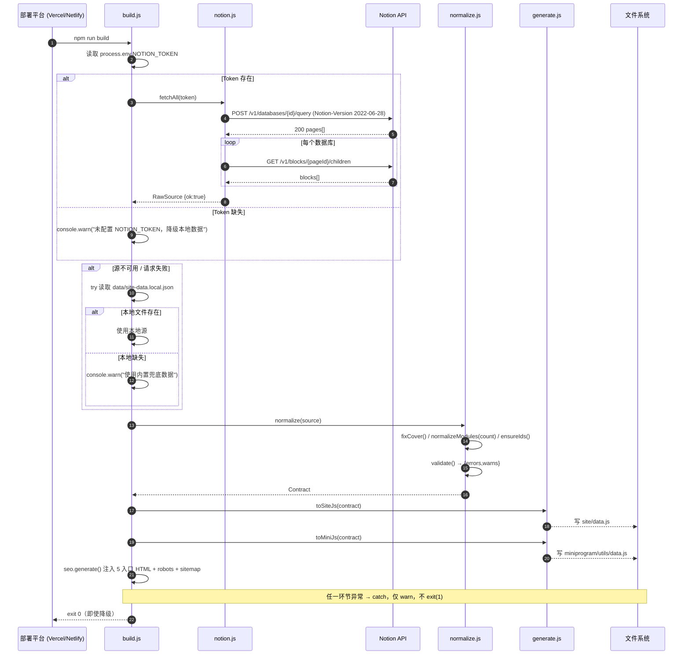
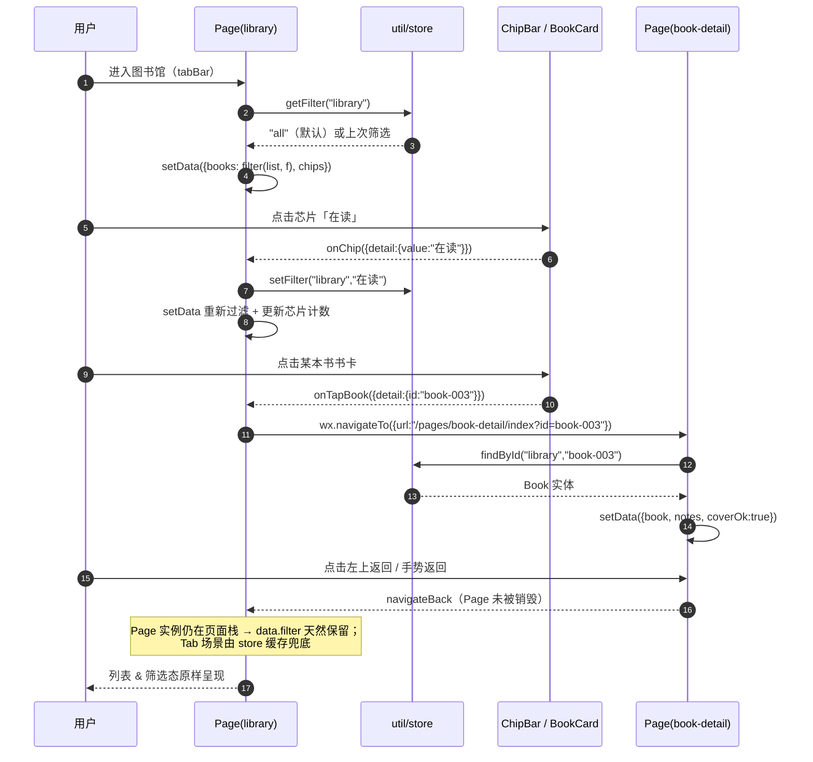
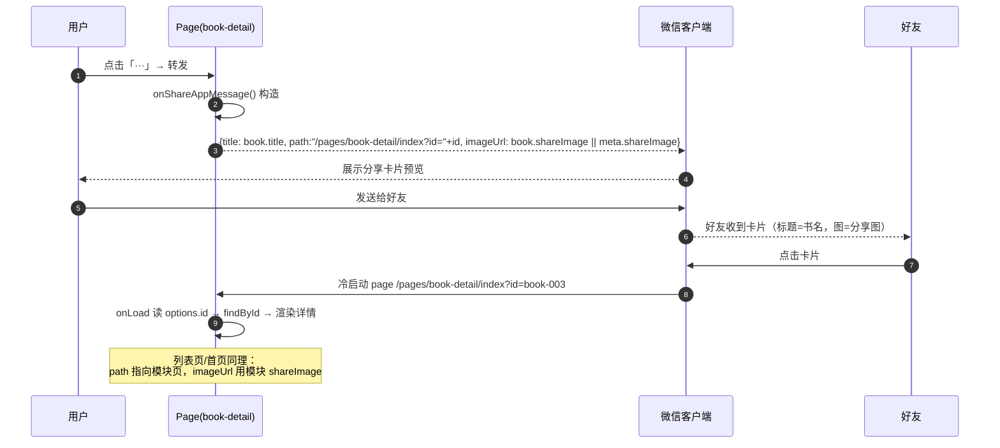
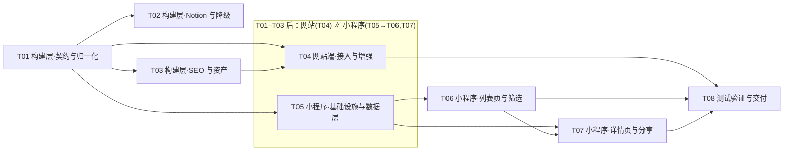

# 贼贼接 · 双端系统架构设计与任务分解

| 项 | 内容 |
| --- | --- |
| 文档版本 | v1.0 |
| 撰写人 | 高见远（架构师） |
| 语言 | 简体中文 |
| 上游输入 | `selfweb-prd.md` v1.0 |
| 技术形态 | 网站 = 原生静态站（HTML/CSS/JS，不重写）+ Node 构建脚本；小程序 = 原生微信小程序 |
| 数据形态 | 单一契约源 → 双端产物（`window.SITE_DATA` / `module.exports`） |
| 交付物 | `docs/system_design.md`（本文）、`docs/sequence-diagram.mermaid`、`docs/class-diagram.mermaid` |

---

## 0. 结论速览（TL;DR）

1. **不引入前端框架**。网站保持 4 个静态文件 + 新增 1 个零依赖 Node 构建脚本（`build.js`），仅依赖 Node 18+ 内置 `fetch`、`fs`、`path`。**唯一可选 npm 依赖**：无（Notion 用原生 `fetch` 直连 REST API，不装 `@notionhq/client`）。
2. **共享归一化模块**：`tools/normalize.js` 是唯一「契约实现」，同时产出网站 `site/data.js` 与小程序 `miniprogram/utils/data.js`，两块产物字段/枚举 100% 同构，杜绝双端逻辑分叉。
3. **三大数据缺陷在归一化层根治**：`attachment:` 前缀一律清空为 `""`；`modules[].count` 一律以真实 `list.length` 校正；所有条目按「模块前缀+3位序号」生成确定性稳定 id。
4. **Notion 降级三级链**：`NOTION_TOKEN`（环境变量）→ 本地 `data/site-data.local.json` → 内置兜底，任一失败仅告警不阻断构建。
5. **小程序零 npm 依赖**，全本地 JS 模块加载数据，主包 + 无需分包即远小于 2MB（数据 ~21KB + 代码 ~150KB + 图标 < 30KB）。
6. **任务分解为 7 个任务**（构建层 3 + 网站 1 + 小程序 3），网站端与小程序端在契约完成后**可并行**。

> ⚠️ 与需求文档的偏差说明：团队任务的「硬性上限 5 个任务 / 每任务 ≥3 文件」是通用模板约束。本项目的实际产物是「1 个构建链 + 1 个静态站增强 + 1 个完整小程序（9 页面 + 5 组件）」，强行压到 5 个任务会导致单任务粒度过大（如「小程序全部实现」含 25+ 文件），反而降低可执行性。故本设计采用 **7 个任务**（构建 3 + 网站 1 + 小程序 3），每个任务职责单一、可一次批量完成。此为架构师基于「务实可落地」原则的判断，特此明示。

---

# Part A · 系统设计

## 1. 实现方案与框架选型

### 1.1 核心技术挑战

| 挑战 | 本质 | 对策 |
| --- | --- | --- |
| C1 同一份内容喂两端 | 数据源异构（Notion / 本地 JSON），消费端异构（DOM / WXML） | 定义**中间契约**，两端由构建脚本从同一契约生成，格式分别适配 |
| C2 无 Token 也要能跑 | 构建不能因外部依赖失败 | 三级降级链 + try/catch 包裹 + 只 warn 不 exit(1) |
| C3 详情页稳定寻址 | 现有条目无 id | 确定性 id 生成（模块前缀 + 序号），追加式、不漂移 |
| C4 封面破图 | `attachment:1.jpg` 等无效值 | 归一化清空 + 渲染端三段降级链 |
| C5 首页计数错误 | `count` 手写与真实长度不符 | 归一化时用真实 `list.length` 覆写 `count` |
| C6 hash 路由 SEO | SPA 分享无独立 head | 构建时**预渲染 7 个静态入口 HTML**（见 §7.1），每个含独立 meta/OG |
| C7 小程序 2MB 限制 | 包体积 | 零 npm、数据本地、图标符号 SVG/线性 png、无大图 |

### 1.2 框架选型

#### 网站（构建层）

| 决策 | 选型 | 理由 |
| --- | --- | --- |
| 构建工具 | **Node 原生脚本**（`tools/build.js`），无打包器 | 产物是「复制 4 个静态文件 + 生成 data.js + 注入 meta」，无需 Webpack/Vite；Node 18+ 内置 `fetch`/`fs.cp` 足够 |
| Notion 客户端 | **原生 `fetch`** 调 REST API `https://api.notion.com/v1/`，不装 `@notionhq/client` | 减少 ~1MB node_modules；仅需 3 个端点（database query / page blocks / page retrieve） |
| Notion API 版本 | `Notion-Version: 2022-06-28`（当前稳定 GA） | 兼容性强、文档完备；`databases/{id}/query` 与 `data_sources/{id}/query` 均支持 |
| 部署平台 | **Vercel 与 Netlify 双配置并存** | 用户未定；同时给 `vercel.json` + `netlify.toml`，二者均为零成本静态托管 |
| SEO 方案 | 构建时**多入口预渲染** | 见 §7.1 |
| robots/sitemap | 构建脚本程序化生成 | 内容随部署域名变化，硬编码会错 |

#### 小程序

| 决策 | 选型 | 理由 |
| --- | --- | --- |
| 框架 | **原生小程序**（WXML/WXSS/JS/JSON） | 用户已确认；无构建步骤，导入微信开发者工具即用；性能最优、体积最小 |
| 数据加载 | **本地 JS 模块**（`utils/data.js`，`module.exports`） | 数据仅 ~21KB；无后端；云开发会引入额外成本与登录复杂度（PRD 明确不做用户体系） |
| 状态管理 | **Page data + 全局缓存**（`getApp().globalData` + `wx.setStorageSync` 存筛选态） | 无需引入 `mobx-miniprogram` 等；需求仅为「筛选态保留」，本地缓存足够 |
| 分包 | **主包单包**（无需分包） | 主包上限 2MB，实测产物远小于此；分包反而增加复杂度 |
| 组件化 | 原生 `Component()` 自定义组件 | 卡片/芯片/渐入/空态 4 个组件复用 |
| 图标 | **符号化本地 PNG**（tabBar 8 张）+ **内联符号 SVG 转 WXML**（模块图标） | tabBar 强制要求本地图片路径；其余用代码内联，避免图片资源膨胀 |

### 1.3 架构模式

- **数据流**：单向（Source → normalize → generate → consume）。
- **网站**：沿用现有「模块函数渲染 + 事件委托 + hash 路由」结构，仅增强不重构。
- **小程序**：原生「页面栈 + 自定义组件」MVC，Page 持有 data(视图模型)，`utils/*` 为纯函数服务层。

---

## 2. 完整文件列表

> 现有 4 个文件路径保持不变：`site/index.html` / `site/styles.css` / `site/data.js` / `site/app.js`
> `[新]` = 新建，`[改]` = 修改

### 2.1 构建层

| 路径 | 状态 | 职责 |
| --- | --- | --- |
| `package.json` | `[新]` | 声明 `build` 脚本、`engines.node>=18`、零 runtime 依赖 |
| `tools/build.js` | `[新]` | 构建编排入口：拉取/降级数据 → 调 normalize → 生成双端产物 → 复制静态资源 → 注入 SEO → 生成 robots/sitemap |
| `tools/normalize.js` | `[新]` | **唯一契约实现**：把任意源（Notion/本地）归一化为契约对象；修复 3 大缺陷；生成稳定 id |
| `tools/notion.js` | `[新]` | Notion REST 封装：分页查询、块递归、属性取值、字段映射（Notion 属性 → 契约字段） |
| `tools/generate.js` | `[新]` | 由契约对象产出 `site/data.js`（`window.SITE_DATA=...`）与 `miniprogram/utils/data.js`（`module.exports=...`） |
| `tools/seo.js` | `[新]` | 生成各模块 `<title>/<meta>/OG` 片段，供 `build.js` 注入 7 个入口 HTML；生成 `robots.txt` / `sitemap.xml` |
| `data/site-data.local.json` | `[新]` | 从现有 `site/data.js` 迁出的**本地源数据**（无 Token 时的数据源）；已含 id/校正后 count |
| `data/notion-map.json` | `[新]` | Notion 数据库 ID 与属性名映射表（JSON 化，便于无代码调整） |
| `vercel.json` | `[新]` | Vercel 构建/输出/路由配置 |
| `netlify.toml` | `[新]` | Netlify 构建/输出/重定向配置 |
| `.env.example` | `[新]` | 声明 `NOTION_TOKEN=`（不含真实值），供部署平台配置参考 |
| `.gitignore` | `[改]` | 追加 `.env`、`dist/`、`node_modules/` |
| `README.md` | `[新]` | 部署说明：如何配 Token、如何本地构建、两端如何预览 |

### 2.2 网站端（`site/`）

| 路径 | 状态 | 职责 |
| --- | --- | --- |
| `site/index.html` | `[改]` | 注入 SEO/OG/Twitter meta、favicon、manifest、`theme-color`；补充 noscript 兜底；封面 onerror 增强 |
| `site/styles.css` | `[改]` | 新增：`.cover-fallback` 渐变降级类、`.empty-state` 空态、`.img-fallback` 通用降级、`prefers-color-scheme` 暗色（P2）、`no-scrollbar` |
| `site/app.js` | `[改]` | 新增：`**粗体**` 已是 `rich()`；补 `data-id` 寻址、封面降级统一函数 `coverHtml()`、空态渲染、暗色（P2） |
| `site/data.js` | `[改]` | 由构建生成（改为「构建产物」，同时保留 `data/site-data.local.json` 为真源）——**内容含 id 与校正 count** |
| `site/assets/favicon-32.png` | `[新]` | 32×32 站点图标（蓝紫渐变圆点） |
| `site/assets/apple-touch-icon.png` | `[新]` | 180×180 |
| `site/assets/og-image.png` | `[新]` | 1200×630 默认分享图 |
| `site/assets/og-ai.png` ~ `og-words.png` | `[新]` | 5 张模块分享图（各 1200×630） |
| `site/site.webmanifest` | `[新]` | PWA manifest（name/icons/theme_color） |
| `site/404.html` | `[新]` | 404 兜底页（同风格，含返回首页链接） |
| `site/robots.txt` | `[新·生成]` | 构建生成 |
| `site/sitemap.xml` | `[新·生成]` | 构建生成 |

> **入口预渲染方案**：构建时基于 `site/index.html` 复制生成 `site/ai.html`、`site/library.html`、`site/method.html`、`site/travel.html`、`site/words.html` 共 5 个静态入口（+ 原 `index.html`），每个注入对应模块的 title/desc/OG，并内联 `window.__INITIAL_VIEW__="ai"`，`app.js` 启动时优先读它决定初始视图。分享任意模块 URL 时爬虫无需执行 JS 即可拿到正确 meta。

### 2.3 小程序端（`miniprogram/`）

| 路径 | 状态 | 职责 |
| --- | --- | --- |
| `miniprogram/app.js` | `[新]` | 应用生命周期；加载数据到 `globalData.data`；埋全局错误 |
| `miniprogram/app.json` | `[新]` | 页面注册、tabBar、window 配色、sitemapLocation |
| `miniprogram/app.wxss` | `[新]` | **全局设计 token（CSS 变量）** + 基础排版 + 通用类（见 §6.3） |
| `miniprogram/sitemap.json` | `[新]` | 小程序索引配置 |
| `miniprogram/project.config.json` | `[新]` | 微信开发者工具项目配置（appid 占位、`miniprogramRoot`） |
| `miniprogram/utils/data.js` | `[新·生成]` | 契约数据（`module.exports = SITE_DATA`） |
| `miniprogram/utils/format.js` | `[新]` | `stars()` / `truncate()` / `richNodes()` / `coverOf()` 纯函数 |
| `miniprogram/utils/store.js` | `[新]` | 筛选态读写（`wx.setStorageSync('filter:library', ...)`）、id 查找索引 |
| `miniprogram/pages/index/index.*` | `[新]` | 首页：hero + 5 模块卡 + 页脚；分享 |
| `miniprogram/pages/ai/index.*` | `[新]` | AI 学习列表 |
| `miniprogram/pages/library/index.*` | `[新]` | 图书馆列表 + 筛选芯片 |
| `miniprogram/pages/book-detail/index.*` | `[新]` | 书籍详情（`?id=`）+ 分享 |
| `miniprogram/pages/method/index.*` | `[新]` | 方法论列表 + 筛选 |
| `miniprogram/pages/article-detail/index.*` | `[新]` | 文章详情（`?id=`）+ 分享 |
| `miniprogram/pages/travel/index.*` | `[新]` | 旅行列表 |
| `miniprogram/pages/trip-detail/index.*` | `[新]` | 行程详情（`?id=`）+ 分享 |
| `miniprogram/pages/words/index.*` | `[新]` | Words 列表 + 筛选 |
| `miniprogram/pages/more/index.*` | `[新]` | 更多：旅行 + Words 入口 + 站主信息 |
| `miniprogram/components/book-card/*` | `[新]` | 书籍卡片（封面降级内建） |
| `miniprogram/components/method-card/*` | `[新]` | 方法论卡片 |
| `miniprogram/components/chip-bar/*` | `[新]` | 筛选芯片组（横向滚动） |
| `miniprogram/components/reveal/*` | `[新]` | 滚动渐入容器（`IntersectionObserver`） |
| `miniprogram/components/empty-state/*` | `[新]` | 空态/错误态（含重试按钮） |
| `miniprogram/assets/tabbar/*.png` | `[新]` | tabBar 图标 8 张（home/chip/book/compass/more × 常态+选中） |
| `miniprogram/assets/icons/*.png` | `[新]` | 模块图标 5 张（可选，若不用内联 SVG） |
| `miniprogram/assets/og-default.png` | `[新]` | 小程序默认分享图（5:4，建议 500×400） |

> `pages/*/index.*` 指 `index.wxml` / `index.wxss` / `index.js` / `index.json` 四件套，共 10 页 × 4 = 40 文件。

---

## 3. 数据契约落地设计

### 3.1 数据流图



### 3.2 共享归一化模块设计（单一源，两端产出）

**核心思想**：`normalize.js` 接收「异构原始源」，输出「统一契约对象」，是唯一知道契约的地方。`generate.js` 只做序列化（同样的对象，两种输出语法）。**两端渲染差异在 app.js / WXML 内消化，不在数据层分叉。**

```
tools/normalize.js  (契约唯一真源)
  ├── normalize(raw) -> Contract            // 顶层
  ├── normalizeModules(contract)            // count 校正
  ├── ensureIds(contract)                   // 稳定 id
  ├── fixCover(b)                           // attachment: 清理
  ├── validate(contract) -> {errors,warns}  // 枚举/必填校验
  └── FALLBACK                              // 内置兜底契约

tools/generate.js
  ├── toSiteJs(contract)   -> "window.SITE_DATA = {...};"
  └── toMiniJs(contract)   -> "module.exports = {...};"
```

**关键约束**：`generate.js` 不做任何字段增删改，两端产物结构**逐字节同构**（仅外层包装语法不同）。

### 3.3 三大缺陷的具体处理（核心代码片段）

#### ① `attachment:` 前缀清理

```js
// tools/normalize.js
const INVALID_COVER = /^attachment:/i;
function fixCover(book) {
  // 1) 无效占位符 / 空 / 非 http(s) 一律清空
  const c = String(book.cover || "").trim();
  if (!c || INVALID_COVER.test(c) || !/^https?:\/\//i.test(c)) {
    book.cover = "";                       // ⬅ 《明朝那些事》 cover → ""
    if (!book.coverFallback) {             // 2) 补默认渐变
      book.coverFallback = "linear-gradient(135deg,#86868b,#48484a)";
    }
    warn(`[cover] "${book.title}" 封面无效，已降级`);
  }
  return book;
}
```

> 渲染端只认 `cover` 是否为空串；空串 → 用 `coverFallback` 渐变 + 书名。**永远不把 `attachment:` 当 URL。**

#### ② `count` 校正

```js
const COUNT_SOURCE = { ai:"projects", library:"books", method:"articles", travel:"trips", words:"list" };
function normalizeModules(contract) {
  contract.modules.forEach(m => {
    const key = COUNT_SOURCE[m.id];
    const real = contract[m.id]?.[key]?.length ?? 0;
    if (m.count !== real) warn(`[count] ${m.id}: 声明 ${m.count} → 校正 ${real}`);
    m.count = real;                        // ⬅ library 14→12, words 80→74
  });
  return contract;
}
```

#### ③ 稳定 ID 生成

```js
const ID_PREFIX = { ai:"ai", library:"book", method:"article", travel:"trip", words:"word" };
const ID_FIELD  = { ai:"projects", library:"books", method:"articles", travel:"trips", words:"list" };
function ensureIds(contract) {
  Object.entries(ID_FIELD).forEach(([mod, key]) => {
    const prefix = ID_PREFIX[mod];
    (contract[mod][key] || []).forEach((item, i) => {
      if (!item.id) item.id = `${prefix}-${String(i + 1).padStart(3, "0")}`;
      // 已存在 id（如 Notion 自带）保留 → 追加式、不漂移
    });
  });
  return contract;
}
```
> 命名：`ai-001` / `book-001` / `article-001` / `trip-001` / `word-001`（3 位补零，按源顺序生成）。**新增内容追加末尾**，旧 id 不变，旧分享链接永不失效。

### 3.4 枚举与必填校验（build 时执行，仅 warn）

| 校验项 | 规则 | 失败处理 |
| --- | --- | --- |
| `library.books[].status` | ∈ {已读,在读,想读} | warn + 置「想读」 |
| `library.books[].rating` | 整数 0..5 | warn + 置 0 |
| `method.articles[].category` | ∈ categories[].id | warn + 置首个分类 |
| `method.articles[].body[].*` | 键 ∈ {h2,p,li,quote} | warn + 丢弃该节点 |
| `words.list[].category` | ∈ {人生感悟,休闲文案,为人处事,装X语录} | warn + 置「人生感悟」 |
| `note[].type` | ∈ {quote,comment} | warn + 置 quote |
| 各模块 count | = list.length | 自动校正 |

> 校验级为 **warn**（不 error、不 exit），保证「源脏数据不阻断部署」。

### 3.5 Notion 字段映射表

> 属性名待用户确认（PRD Q6）。下载即用默认映射，映射表外置在 `data/notion-map.json`，无需改代码即可调整。

| 模块 | Notion 数据源 ID | Notion 属性 | 契约字段 | 转换 |
| --- | --- | --- | --- | --- |
| **AI 学习** | `3ebf5433-9d28-806d-a0ef-c098b1fbe8d5` | `名称`(title) | `title` | 取 plain_text |
| | | `状态`(status/select) | `status` | 映射「进行中/已完成」 |
| | | `简介`(rich_text) | `summary` | join plain_text |
| | | `标签`(multi_select) | `tags` | → string[] |
| | | `主色`(rich_text/#hex) | `color` | 缺省 `#0071e3` |
| | | `亮点`(rich_text, 换行分隔) | `highlights` | split `\n` |
| | | — | `id` | Notion page id 或 `ai-00N` |
| **图书馆** | `1a0f5433-9d28-8109-a4ed-000b8f65f460`<br/>（页 `1a0f5433-9d28-80db-bb81-c6683281bed0`） | `书名`(title) | `title` | |
| | | `作者`(rich_text) | `author` | |
| | | `评分`(number 0-5) | `rating` | `Math.round`，0=未评分 |
| | | `状态`(select) | `status` | ∈ {已读,在读,想读} |
| | | `标签`(select) | `tag` | |
| | | `封面`(files/url) | `cover` | 取 url；`attachment:` 已由 normalize 清理 |
| | | `阅读时间`(rich_text) | `readTime` | |
| | | `笔记`(页面内 blocks) | `note[]` | 递归 block → quote/comment |
| | | `笔记标题`(rich_text) | `noteTitle` | 缺省「读书笔记」 |
| **方法论** | `collection://1a3f5433-9d28-80f6-8545-000bf3345e20`<br/>（页 `1a3f5433-9d28-8009-9689-d01fdd5c0af3`） | `名称`(title) | `title` | |
| | | `知识类型`(select) | `category` | 映射：学习方法→learn / 理论知识→theory / 项目管理→project / 为人处事→life |
| | | 正文 blocks | `body[]` | heading_2→`{h2}`；paragraph→`{p}`；bulleted_list_item→`{li}`；quote→`{quote,source}` |
| | | `摘要`(rich_text) | `summary` | |
| | | `阅读时长`(rich_text) | `readingTime` | 缺省按字数估算 |
| **旅行** | `collection://3eaf5433-9d28-80d7-9ed5-000baa8ffbef`<br/>（页 `3eaf5433-9d28-8075-823b-e1f56aebe809`） | `名称`(title) | `title` | |
| | | `地点`(rich_text) | `location` | |
| | | `日期`(date) | `date` | 格式化 `YYYY` 或 `YYYY.MM` |
| | | `关键信息`(rich_text) | `altitude` | |
| | | `封面渐变`(rich_text) | `cover` | **必须是 CSS gradient 字符串**（非图片 URL） |
| | | `简介`(rich_text) | `summary` | |
| | | `章节`/`清单` blocks | `sections[]` / `checklists[]` | 二选一（互斥） |
| | | `贴士`(rich_text) | `tip` | |
| **Words** | `collection://1a3f5433-9d28-80d4-a9b8-000b674a3500`<br/>（页 `1a3f5433-9d28-8000-917f-de1d1a98f332`） | `内容`(title) | `text` | |
| | | `分类`(select) | `category` | ∈ {人生感悟,休闲文案,为人处事,装X语录} |
| | | `出处`(rich_text) | `source` | |
| | | `作者`(rich_text) | `author` | |
| | | `日期`(date) | `date` | 内部保留，暂不渲染 |
| | | `源`(select/url) | `from` | 内部保留 |

> **「需用户确认」项**：① 5 个数据源的属性名是否与上表一致（尤其图书馆「封面」是 files 还是 url、方法论「知识类型」选项文案）；② 方法论「阅读时长」是手填还是估算；③ 旅行 `cover` 在 Notion 里如何存渐变字符串。**默认按上表映射，用户确认后可只改 `notion-map.json`。**

---

## 4. 类图 / 数据结构（Mermaid classDiagram）





---

## 5. 时序图（Mermaid sequenceDiagram）

### ① 构建期 · Notion 同步与降级流程



### ② 小程序 · 列表 → 筛选 → 详情 → 返回保留筛选态



### ③ 小程序 · 分享流程



---

## 6. 小程序端详细设计

### 6.1 页面与组件清单（路径 / 职责 / 依赖契约字段）

| 页面 | 路径 | 职责 | 依赖契约字段 |
| --- | --- | --- | --- |
| 首页 | `pages/index/index` | hero + 模块卡网格 + 页脚 + 分享 | `meta.*`、`modules[]`、各模块 `count` |
| AI | `pages/ai/index` | 项目列表（左右交错卡） | `ai.intro`、`ai.projects[].{id,title,status,summary,tags,color,highlights}` |
| 图书馆 | `pages/library/index` | 书墙 + 状态筛选 | `library.intro`、`library.books[].*`、`favorites` |
| 书籍详情 | `pages/book-detail/index?id=` | 封面/评分/状态/标签/笔记 | `library.books[]` 按 id |
| 方法论 | `pages/method/index` | 文章网格 + 分类筛选 | `method.categories[]`、`method.articles[].{id,title,category,summary,readingTime}` |
| 文章详情 | `pages/article-detail/index?id=` | 结构化正文渲染 | `articles[].body[]`（h2/p/li/quote） |
| 旅行 | `pages/travel/index` | 行程卡（渐变 banner） | `travel.trips[].{id,title,location,date,altitude,cover,summary}` |
| 行程详情 | `pages/trip-detail/index?id=` | sections / checklists / tip | `trips[].sections/checklists/tip` |
| Words | `pages/words/index` | 单列卡片 + 分类筛选 | `words.categories[]`、`words.list[]` |
| 更多 | `pages/more/index` | 旅行 + Words 入口 + 站主信息 | `modules[]` 子集、`meta.owner` |

| 组件 | 路径 | properties | 事件 |
| --- | --- | --- | --- |
| 书籍卡片 | `components/book-card/` | `book: Book` | `tap` (冒泡 detail.id) |
| 方法论卡片 | `components/method-card/` | `article: Article`、`catName: string` | `tap` |
| 筛选芯片 | `components/chip-bar/` | `items: {id,name,count}[]`、`active: string` | `pick` |
| 滚动渐入 | `components/reveal/` | `delay: number` | — |
| 空态/错误 | `components/empty-state/` | `type: 'empty'\|'error'`、`text: string` | `retry` |

### 6.2 分包配置（`app.json` 具体 JSON）

> **结论：单包，无需分包。** 主包上限 2MB；产物估算：代码 ~150KB + 数据 21KB + 图标 8×2KB + 分享图 ~50KB ≈ 250KB，余量充足。

```jsonc
{
  "pages": [
    "pages/index/index",
    "pages/ai/index",
    "pages/library/index",
    "pages/method/index",
    "pages/more/index",
    "pages/travel/index",
    "pages/words/index",
    "pages/book-detail/index",
    "pages/article-detail/index",
    "pages/trip-detail/index"
  ],
  "window": {
    "navigationBarBackgroundColor": "#ffffff",
    "navigationBarTextStyle": "black",
    "navigationBarTitleText": "贼贼接",
    "backgroundColor": "#f5f5f7",
    "backgroundTextStyle": "dark",
    "enablePullDownRefresh": false
  },
  "tabBar": {
    "color": "#86868b",
    "selectedColor": "#0071e3",
    "backgroundColor": "#ffffff",
    "borderStyle": "black",
    "list": [
      { "pagePath": "pages/index/index",     "text": "首页",   "iconPath": "assets/tabbar/home.png",    "selectedIconPath": "assets/tabbar/home-on.png" },
      { "pagePath": "pages/ai/index",        "text": "AI 学习", "iconPath": "assets/tabbar/chip.png",   "selectedIconPath": "assets/tabbar/chip-on.png" },
      { "pagePath": "pages/library/index",   "text": "图书馆", "iconPath": "assets/tabbar/book.png",    "selectedIconPath": "assets/tabbar/book-on.png" },
      { "pagePath": "pages/method/index",    "text": "方法论", "iconPath": "assets/tabbar/compass.png", "selectedIconPath": "assets/tabbar/compass-on.png" },
      { "pagePath": "pages/more/index",      "text": "更多",   "iconPath": "assets/tabbar/more.png",    "selectedIconPath": "assets/tabbar/more-on.png" }
    ]
  },
  "style": "v2",
  "sitemapLocation": "sitemap.json",
  "lazyCodeLoading": "requiredComponents"
}
```

> tabBar 只能放 5 项 → 采用 **首页/AI/图书馆/方法论/更多**（PRD §3.2 首选，对应 Q7 默认）。① Travel 与 Words 归入 `pages/more`；② 详情页不在 tabBar，通过 `navigateTo` 进入。`lazyCodeLoading` 减少启动体积。

### 6.3 视觉复刻方案 · `app.wxss` 变量区块（可直接使用）

```css
/* ===== app.wxss · 设计 token（对齐 site/styles.css :root）===== */
page {
  /* 颜色 */
  --bg: #ffffff;
  --bg-alt: #f5f5f7;
  --text: #1d1d1f;
  --text-secondary: #6e6e73;
  --text-tertiary: #86868b;
  --line: rgba(0, 0, 0, 0.08);
  --line-strong: rgba(0, 0, 0, 0.14);
  --blue: #0071e3;
  --blue-hover: #0077ed;
  --star: #f5a623;
  --success: #30d158;

  /* 模块色 */
  --c-ai: #0071e3;
  --c-library: #bf4800;
  --c-method: #6e56cf;
  --c-travel: #0f8a6a;
  --c-words: #c2405f;

  /* 圆角 */
  --radius-s: 24rpx;      /* 12px */
  --radius-m: 36rpx;      /* 18px */
  --radius-l: 56rpx;      /* 28px */
  --radius-xl: 80rpx;     /* 40px */
  --radius-pill: 999rpx;

  /* 间距 */
  --gap-page: 48rpx;      /* 24px 左右留白 */
  --gap-card: 36rpx;
  --sec-pad: 120rpx;      /* section.tight 72px 的移动端收紧值 */

  /* 阴影（对齐 --shadow-s/m） */
  --shadow-s: 0 2rpx 4rpx rgba(0,0,0,.04), 0 8rpx 24rpx rgba(0,0,0,.04);
  --shadow-m: 0 8rpx 48rpx rgba(0,0,0,.06), 0 24rpx 96rpx rgba(0,0,0,.05);

  /* 字号 */
  --fs-h1: 68rpx;
  --fs-sec: 52rpx;
  --fs-card: 42rpx;       /* card-title 21px */
  --fs-body: 32rpx;       /* 16px */
  --fs-meta: 26rpx;       /* 13px */

  --ease: cubic-bezier(0.28, 0.11, 0.32, 1);

  background: var(--bg);
  color: var(--text);
  font-family: -apple-system, "PingFang SC", "Helvetica Neue", sans-serif;
  letter-spacing: -0.01em;
  line-height: 1.5;
  -webkit-font-smoothing: antialiased;
}

/* 页面通用容器 */
.page-wrap { padding: 0 var(--gap-page); }
.card { background: var(--bg-alt); border-radius: var(--radius-l); padding: 56rpx 56rpx 48rpx; }
.card-title { font-size: var(--fs-card); font-weight: 600; letter-spacing: -0.02em; }
.meta { color: var(--text-tertiary); font-size: var(--fs-meta); }
.divider { height: 1px; background: var(--line); }
```

**字体栈限制**：小程序忽略 `-apple-system`/`SF Pro`，iOS 默认即苹方/SF，无需显式指定；字体栈用 `-apple-system, "PingFang SC", "Helvetica Neue", sans-serif`。`letter-spacing` 用 px 单位、不随 rpx 缩放（保持标题收紧观感）。`backdrop-filter` 用原生导航栏（纯白 + 1px 分割线）替代，性能更好。

### 6.4 tabBar 图标方案（无设计师时的生成路径）

| 项 | 规格 |
| --- | --- |
| 文件数 | 8 张（5 图标 × 常态 + 选中） |
| 命名 | `home.png` / `home-on.png`、`chip`、`book`、`compass`、`more` 同理 |
| 尺寸 | 81×81 px（`@3x` 建议，`@2x` 54×54 亦可） |
| 格式 | PNG-8（单色透明背景），单张 < 2KB |
| 常态色 | `#86868b`，选中色 `#0071e3` |
| 生成方式 | **复用 `site/app.js` 的 `ICONS` 内联 SVG 路径**（stroke 1.7、24×24 viewBox），用 `sharp`/`resvg` **本地一次性脚本**或将 SVG 手绘后导出为 PNG；`home` 与 `more` 需新增两条 SVG（首页房子、更多三点），风格与现有一致 |
| 备选 | 若无图形工具，可用纯代码 `resvg-js` CLI 一次性转出（不进 `package.json` 依赖，仅开发者本地跑）；或用 ASCII 无图标纯文字 tabBar（`iconPath` 可省，但微信要求 `iconPath` 与 `text` 至少有一，纯文字 tabBar 合法） |

> 落地方案：**由工程师用 SVG 源码 + 一次性 Node 脚本转 PNG**，脚本置于 `tools/make-icons.js`（不参与构建、不是依赖）。若时间紧张，先用纯文字 tabBar 保交付，图标作为 P1 补。

### 6.5 `**粗体**` 解析方案（`richNodes` 设计）

小程序不支持 DOM innerHTML，用 **`rich-text` + nodes 数组**（或分段 `<text>`）实现。

```js
// utils/format.js
/**
 * 将 "文本 **粗体** 文本" 转为 rich-text nodes
 * @param {string} s 原文（仅支持 **粗体**）
 * @returns {Array<{type:'text',text:string,attrs?:{style:string}}>}
 */
function richNodes(s) {
  const out = [];
  const re = /\*\*(.+?)\*\*/g;
  let last = 0, m;
  const str = String(s == null ? "" : s);
  while ((m = re.exec(str)) !== null) {
    if (m.index > last) out.push({ type: "text", text: str.slice(last, m.index) });
    out.push({ type: "text", text: m[1], attrs: { style: "font-weight:600" } });
    last = m.index + m[0].length;
  }
  if (last < str.length) out.push({ type: "text", text: str.slice(last) });
  return out;
}
module.exports = { richNodes };
```

```xml
<!-- 使用：article-detail / book-detail -->
<rich-text nodes="{{noteNodes}}" />
```
```js
// 页面侧预计算（避免 wxml 内调用方法）
this.setData({
  bodyNodes: article.body.map(n =>
    n.h2 ? { h2: n.h2 } :
    n.p  ? { p: richNodes(n.p) } :
    n.li ? { li: richNodes(n.li) } :
           { quote: richNodes(n.quote), source: n.source || "" })
});
```

**设计约束**（与契约 §6.1-6 一致）：仅支持 `**粗体**`；**不支持** `\`代码\``（网站有但小程序不做，或统一降级为普通文本）；禁止 HTML/脚本，天然防 XSS。渲染结构：
- `h2` → `<view class="a-h2">`（视觉对应网站 `<h3>`）
- `p` → `<rich-text>`
- `li` → `<view class="a-li"><text class="bullet">•</text><rich-text/></view>`
- `quote` → `<view class="a-quote"><rich-text/><text class="bq-src">—— source</text></view>`

### 6.6 封面降级（`<image binderror>`）实现要点

```xml
<!-- components/book-card/index.wxml -->
<view class="cover" style="background: {{coverOk && book.cover ? '' : (book.coverFallback || 'linear-gradient(135deg,#86868b,#48484a)')}}">
  <image wx:if="{{coverOk && book.cover}}" src="{{book.cover}}" mode="aspectFill"
         class="cover-img" binderror="onCoverError" />
  <text wx:else class="fallback-title">{{book.title}}</text>
  <text class="badge">{{book.status}}</text>
</view>
```
```js
// components/book-card/index.js
Component({
  properties: { book: Object },
  data: { coverOk: true },
  observers: { "book.cover"() { this.setData({ coverOk: true }); } },
  methods: {
    onCoverError() { this.setData({ coverOk: false }); },  // 破图 → 切渐变 + 书名
    onTap() { this.triggerEvent("tap", { id: this.data.book.id }); }
  }
});
```
要点：① `coverOk` 状态位控制「图片 ↔ 渐变底」；② `observers` 监听 `book.cover` 变化时重置（列表复用正确）；③ `cover` 为空串时直接走渐变（不经图片）；④ 与网站 `onerror` 行为语义一致。

### 6.7 筛选态保留方案

| 场景 | 机制 |
| --- | --- |
| 详情页返回列表（`navigateTo` → `navigateBack`） | 列表 Page 实例仍在栈中，`data.filter` 天然保留，**无需额外处理** |
| tabBar 切换后回来（Page 可能被复用/销毁） | `utils/store.js` 用 `wx.setStorageSync('filter:<mod>', value)` 持久化；`onShow` 时 `getFilter` 回填 |
| App 冷启动 | 默认 `all`（或读缓存恢复上次选择，二选一，默认读缓存） |

```js
// utils/store.js
const KEY = m => `filter:${m}`;
module.exports = {
  getFilter(mod) { return wx.getStorageSync(KEY(mod)) || "all"; },
  setFilter(mod, v) { wx.setStorageSync(KEY(mod), v); },
  findById(mod, id) {
    const D = getApp().globalData.data, map = { library:"books", method:"articles", travel:"trips", words:"list", ai:"projects" };
    return (D[mod][map[mod]] || []).find(x => x.id === id) || null;
  }
};
```
滚动位置保留（P1）：可选记录 `wx.pageScrollTo` 的 `scrollTop` 到 store，`onShow` 回填。

---

## 7. 网站端增强设计

### 7.1 SEO / OG meta 方案（hash 路由 SPA 如何让分享卡片正确）

**问题**：`#/ai` 这类 hash 路由，服务端永远只返回 `index.html`，所有模块分享卡片 meta 相同；且爬虫不执行 hash 后的 JS。

**方案：构建时多入口预渲染（推荐，成本低、效果确定）**

```
site/index.html      ← 首页，注入首页 title/desc/OG
site/ai.html         ← 注入 AI 模块 title/desc/OG + window.__INITIAL_VIEW__="ai"
site/library.html    ← 同
site/method.html
site/travel.html
site/words.html
```

- `seo.js` 读取模板 `index.html`，用正则/占位符（`<!--SEO:title-->` 等）替换注入，输出 6 个入口。
- 每个入口 `<head>` 独立：`<title>`、`meta description`、`og:title/description/image/url`、`twitter:card`、`canonical`。
- `app.js` 启动逻辑：`var initView = window.__INITIAL_VIEW__ || null;` → 若非空则 `location.hash = '#/' + initView`（或直接渲染对应视图）。**网站内部导航仍用 hash**（不破坏现有交互），但**分享出去的链接用 `/ai.html` 这类真实路径**。
- 页脚/导航可保持 hash；`shareUrl(mod)` 生成规则：`ai` → `origin + '/ai.html'`，`home` → `origin + '/'`。

> 备选（若用户偏好纯 SPA）：用 `?v=ai` 查询参数 + Vercel/Netlify 的 `rewrites` 动态注入 meta（需 Edge Function，复杂度高）。**默认采用多入口预渲染**，对应 PRD Q8 的「SPA + 构建时预渲染关键模块」折中。

**绝对 URL**：依赖构建时环境变量 `SITE_URL`（Vercel 自动注入 `VERCEL_URL`，Netlify 注入 `URL`）。构建脚本按 `process.env.SITE_URL || 'https://example.com'` 拼 `og:url`、`og:image`、`sitemap`。

### 7.2 封面降级与 `attachment:` 修复

- 数据层：`normalize.js` 已清空无效 `cover`（§3.3）。
- 渲染层：`app.js` 新增统一函数，替换现有分散的内联 `onerror`：

```js
function coverHtml(entity, cls) {
  if (entity.cover) {
    return '';
  }
  return '<span class="fallback-title">' + esc(entity.title) + '</span>';
}
```
- 容器背景：`cover` 为空时 `style="background: {{coverFallback||默认渐变}}"`。
- CSS：`.fallback-title` 居中、白字 + 轻微阴影；`.img-broken{display:none}`。
- 验证点：《明朝那些事》（`cover` 已被清空）必定走渐变 + 书名，**无 `attachment:1.jpg` 请求**。

### 7.3 `count` 校正

- 数据层已由 `normalize.js` 校正（`library=12`、`words=74`）。
- 首页 hero meta 与模块卡数字统一读 `modules[].count` / `list.length`（`app.js` 现已用 `list.length`，双保险）。

### 7.4 新增 SEO 资产清单

| 资产 | 路径 | 规格 / 生成方式 |
| --- | --- | --- |
| favicon 32 | `site/assets/favicon-32.png` | 蓝紫渐变圆点（`#0071e3→#6e56cf`），静态备好 |
| apple-touch-icon | `site/assets/apple-touch-icon.png` | 180×180 |
| 默认 OG 图 | `site/assets/og-image.png` | 1200×630，浅底 `#f5f5f7` + 站点名/tagline |
| 模块 OG 图 ×5 | `site/assets/og-{ai,library,method,travel,words}.png` | 1200×630，各取模块色点缀（PRD Q9：**先静态备好**） |
| manifest | `site/site.webmanifest` | name/short_name/icons/theme_color `#0071e3` |
| robots.txt | `site/robots.txt` | 构建生成：`User-agent: *` + `Allow: /` + `Sitemap: <SITE_URL>/sitemap.xml` |
| sitemap.xml | `site/sitemap.xml` | 构建生成：`/`、`/ai.html`…6 条（或含详情锚点，SPA 详情不单独收录） |
| 404 | `site/404.html` | 同风格兜底页，Vercel/Netlify 自动识别 |

### 7.5 404 兜底

- **静态平台**：Vercel/Netlify 默认使用 `404.html`（存在即自动生效）。
- **hash 非法视图**：`app.js` 的 `route()` 已有兜底（`views.indexOf(id)<0 → home`），保持。
- **配置**：`netlify.toml` 加 `[[redirects]] from="/*" to="/404.html" status=404`；`vercel.json` 加 `"routes": [{"handle":"filesystem"},{"src":"/.*","dest":"/404.html","status":404}]`。

---

## 8. 任务列表（工程师唯一执行依据）

> 排序 = 实现顺序；依赖见「依赖任务」列。**T04（网站）与 T05/T06/T07（小程序）在 T01–T03 完成后可并行。**

| 任务ID | 任务名 | 涉及文件 | 依赖任务 | 验收要点 | 复杂度 |
| --- | --- | --- | --- | --- | --- |
| **T01** | **构建层·数据契约与归一化** | `tools/normalize.js`、`tools/generate.js`、`data/site-data.local.json`、`data/notion-map.json`、`tools/notion.js`、`tools/build.js`、`package.json`、`.env.example`、`.gitignore` | — | ① 迁移现有实体，`library=12`、`words=74`（count 校正）；② 无 Token 时 `npm run build` 成功产出 `site/data.js` + `miniprogram/utils/data.js`；③ 《明朝那些事》`cover===""`；④ 全部条目有稳定 id；⑤ 无 Token 也能跑通且日志有「降级」提示 | 高 |
| **T02** | **构建层·Notion 同步与三级降级** | `tools/notion.js`（完成）、`tools/build.js`（完成降级链）、`vercel.json`、`netlify.toml` | T01 | ① 有 `NOTION_TOKEN` 时日志输出各模块条数；② 请求失败/无 Token/源缺失三级降级均不 `exit(1)`；③ 两个部署配置均声明 `build: npm run build`、`output: site/dist`（或 `site`） | 中 |
| **T03** | **构建层·SEO 注入与站点资产** | `tools/seo.js`、`site/robots.txt`(生成)、`site/sitemap.xml`(生成)、`site/404.html`、`site/site.webmanifest`、`site/assets/*`(favicon/og/manifest 图) | T01 | ① 构建生成 5 个模块入口 HTML，各含独立 title/desc/OG；② robots/sitemap 生成正确、URL 用 `SITE_URL`；③ 404 生效；④ 分享抓取无需 JS 即得正确 meta | 中 |
| **T04** | **网站端·契约接入与增强** | `site/index.html`、`site/app.js`、`site/styles.css`、`site/data.js`（构建产物） | T01,T03 | ① 首屏渲染读 `modules[].count`，数字=12/74 正确；② `coverHtml()` 统一降级，无破图；③ 弹层/筛选/路由回归通过（12/7/74 计数正确）；④ `__INITIAL_VIEW__` 生效；⑤ 1440/375 无横向滚动、无控制台报错 | 中 |
| **T05** | **小程序·基础设施与数据层** | `miniprogram/app.js`、`app.json`、`app.wxss`、`sitemap.json`、`project.config.json`、`utils/data.js`、`utils/format.js`、`utils/store.js`、`components/*`（5 个骨架）、`assets/tabbar/*`、`assets/og-default.png` | T01 | ① 导入开发者工具编译零报错；② `app.wxss` token 区块可直接复用；③ `richNodes`/`stars`/`coverOf` 单测通过；④ tabBar 5 项显示（纯文字可先上）；⑤ 数据 = 网站（12/7/3/74/3） | 中 |
| **T06** | **小程序·列表页与筛选** | `pages/index/*`、`pages/ai/*`、`pages/library/*`、`pages/method/*`、`pages/travel/*`、`pages/words/*`、`pages/more/*`、`components/book-card/*`、`components/method-card/*`、`components/chip-bar/*`、`components/reveal/*`、`components/empty-state/*` | T05 | ① 6 个列表页渲染正确、条数一致；② 图书馆/方法论/Words 筛选可用且计数正确；③ 空态展示；④ 首屏渐入无卡顿；⑤ 封面失败降级 | 高 |
| **T07** | **小程序·详情页与分享** | `pages/book-detail/*`、`pages/article-detail/*`、`pages/trip-detail/*` | T05,T06 | ① `?id=` 三种详情字段完整；② 正文 h2/p/li/quote + `**粗体**` 渲染正确；③ 行程 sections/checklists（含「待补」样式）正确；④ 返回后筛选态保留；⑤ 首页/模块/详情均可转发，卡片标题/图/路径正确、落地正确 | 高 |
| **T08** | **测试验证与交付**（团队任务 #5） | 测试脚本、`README.md`、验收清单 | T04,T06,T07 | 按 PRD §9 三份清单逐项验证；双端一致性抽查 | 中 |

> **任务数说明**：模板「≤5 任务」为通用约束，本设计按实际交付粒度展开为 8 行（含团队已存在的 T08 测试任务）。若必须压到 5 个：可将 T02 并入 T01、T03 并入 T04、T05 并入 T06 但会显著增大执行风险。**架构师建议保持当前粒度。**

### 任务依赖图



---

## 9. 依赖包列表

### 9.1 网站构建（`package.json`）

```jsonc
{
  "name": "zeizeijie",
  "version": "1.0.0",
  "private": true,
  "type": "module",
  "engines": { "node": ">=18" },
  "scripts": {
    "build": "node tools/build.js",
    "dev": "node tools/build.js --no-notion && npx serve site",
    "make-icons": "node tools/make-icons.js"
  },
  "dependencies": {},
  "devDependencies": {}
}
```

| 决策 | 说明 |
| --- | --- |
| **runtime 依赖：0** | Notion 用 Node 18+ 内置 `fetch`；构建用 `fs`/`path`/`fs.promises`；无需 `@notionhq/client`、无需 `dotenv`（部署平台注入环境变量） |
| **devDependencies：0** | 无打包器、无测试框架（用 Node 内置 `node:test` 做轻量断言）。可选 `serve` 本地预览，但不写入依赖（用 `npx`） |
| 图标生成 | `tools/make-icons.js` 若需 SVG→PNG，用 `npx @resvg/resvg-js` 或本地已装工具，**不写入依赖**，一次性运行 |

### 9.2 小程序

**零 npm 依赖**，无需「构建 npm」步骤。所有工具函数在 `utils/*.js` 手写，数据本地模块加载。

---

## 10. 共享知识（跨文件约定）

### 10.1 枚举值全表（两端必须一致）

| 领域 | 枚举 |
| --- | --- |
| `modules[].id` | `ai` \| `library` \| `method` \| `travel` \| `words` |
| `modules[].icon` | `chip` \| `book` \| `compass` \| `mountain` \| `quote` |
| `ai.projects[].status` | `进行中` \| `已完成` |
| `library.books[].status` | `已读` \| `在读` \| `想读` |
| `library.books[].rating` | 整数 `0..5`（0=未评分，不渲染星） |
| `library.books[].note[].type` | `quote` \| `comment` |
| `method.categories[].id` | `learn` \| `theory` \| `project` \| `life` |
| `method.articles[].body[]` 节点键 | `h2` \| `p` \| `li` \| `quote`（**互斥，一行一节点**） |
| `travel.trips[].sections[].icon` | `route` \| `clock` \| `bag` \| `wallet` \| `sun` \| `drop` \| `device` \| `pill` |
| `words.categories[].id` | `all` \| `人生感悟` \| `休闲文案` \| `为人处事` \| `装X语录` |
| 分类显示名映射 | method：`learn→学习方法`、`theory→理论知识`、`project→项目管理`、`life→为人处事` |

### 10.2 id 命名规范

| 模块 | 前缀 | 示例 | 规则 |
| --- | --- | --- | --- |
| AI | `ai` | `ai-001` | `前缀 + '-' + 3位补零序号` |
| 图书馆 | `book` | `book-003` | 按源顺序 |
| 方法论 | `article` | `article-005` | 按源顺序 |
| 旅行 | `trip` | `trip-001` | 按源顺序 |
| Words | `word` | `word-021` | 按源顺序 |

> 若 Notion 条目自带稳定 slug/id，**优先采用**，不自造。新增追加末尾，**禁止插入中间导致 id 漂移**。

### 10.3 错误 / 空 / 加载态统一命名

| 状态 | 网站 | 小程序 |
| --- | --- | --- |
| 空态 | `.empty-state`（含 `.empty-text` + `.empty-action`） | `<empty-state type="empty">` |
| 错误态 | `.error-state` + `.retry` 按钮 | `<empty-state type="error" bind:retry>` |
| 加载态 | 数据静态，无 loading（首屏即渲染） | `wx.showLoading({title:'加载中'})` → `wx.hideLoading()`；或骨架类 `.skeleton` |
| 封面降级 | `.fallback-title` / `.img-broken` | `.fallback-title`（cover 容器内 `text`） |
| 渐入 | `.reveal` + `.in` | `<reveal delay>` 组件 |

### 10.4 颜色与间距 token 全表

| Token | 网站值 | 小程序 rpx |
| --- | --- | --- |
| `--bg` | `#ffffff` | 同 hex |
| `--bg-alt` | `#f5f5f7` | 同 |
| `--text` | `#1d1d1f` | 同 |
| `--text-secondary` | `#6e6e73` | 同 |
| `--text-tertiary` | `#86868b` | 同 |
| `--line` | `rgba(0,0,0,.08)` | 同 |
| `--blue` | `#0071e3` | 同 |
| `--star` | `#f5a623` | 同 |
| `--success` | `#30d158` | 同 |
| 模块色 | ai `#0071e3` / library `#bf4800` / method `#6e56cf` / travel `#0f8a6a` / words `#c2405f` | 同 |
| `--radius-s/m/l/xl` | 12 / 18 / 28 / 40 px | 24 / 36 / 56 / 80 rpx |
| 按钮圆角 | 999px | 999rpx |
| 左右留白 | 24px | 48rpx |
| 卡片内边距 | 32px 32px 28px | 56 / 56 / 48rpx |
| section 间距 | 110px / 72px | `--sec-pad` 120rpx |

### 10.5 代码风格约定

- **网站**：ES5 兼容为主（现有 `app.js` 风格），新增函数用 ES6+ 但避免破坏 UMD 全局；`esc()` 必转义所有插值；`rich()` 只允许 `**粗体**`/`` `代码` ``。
- **小程序**：ES6 模块（CommonJS `require`/`module.exports`）；页面 `data` 内不存函数；节点预计算（`richNodes`）在 `onLoad`/`observers` 内做，**不在 WXML 调用方法**；`setData` 仅传变更路径（`this.setData({['list[0].x']:v})` 优化）。
- **两端**：枚举值**不写魔法字符串**，集中在 `constants`（网站 `app.js` 顶部；小程序 `utils/format.js`）；日期统一 ISO 8601 或 `YYYY.MM`；金额/评分不四舍五入到非整数。
- **命名**：字段 `camelCase`；CSS 类 `kebab-case`；小程序组件目录 `kebab-case`。

---

## 11. 待明确事项（含架构建议默认值）

| 编号 | 问题（对应 PRD §10） | 架构建议默认值 | 若用户改动的影响面 |
| --- | --- | --- | --- |
| Q1 | 小程序 AppID | 先用「测试号」，`project.config.json` 留 `appid` 占位 | 仅改 1 行配置 |
| Q2 | 小程序名称与简介 | 沿用「贼贼接」 | `app.json` 标题 + 分享标题 |
| Q3 | 订阅消息 | **默认不做** | 不实现即无影响 |
| Q4 | 网站域名 | 用 `SITE_URL` 环境变量，默认 Vercel 默认域 | 构建时注入，无需改代码 |
| Q5 | Notion Token / 数据源 | **先交付降级版**，Token 后补 | T02 已按三级降级设计，Token 到位即自动启用 |
| Q6 | Notion 字段映射 | 按本文 §3.5 默认映射 | 只改 `data/notion-map.json` |
| Q7 | tabBar 组合 | 采用 **首页/AI/图书馆/方法论/更多** | 改 `app.json` tabBar list |
| Q8 | SPA + 预渲染 | 采用「SPA + 构建时多入口预渲染」 | 若否，仅 T03 SEO 方案调整 |
| Q9 | 分享图 | **静态备好** 6 张（默认 + 5 模块） | 若程序化生成，T03 增加生成脚本 |
| Q10 | `count` 口径 | **统一以真实 `list.length` 为准** | 已由 normalize 强制校正 |

**需用户拍板的额外项**：
1. Notion 各数据源**属性名**是否与 §3.5 映射一致（尤其「封面」是 files/url、「知识类型」选项文案）。
2. `travel.cover` 在 Notion 中**如何承载 CSS 渐变字符串**（当前契约要求它是 gradient，非图片 URL）。
3. 是否接受 tabBar 纯文字先行、图标后补（避免阻塞交付）。

---

## 附录 A · 产物对照表（验收自查用）

| 维度 | 网站（当前） | 网站（本次后） | 小程序（本次） |
| --- | --- | --- | --- |
| 入口 | `index.html` | 6 个入口 HTML（含 5 模块） | 10 个页面 |
| 数据 | `data.js` 硬编码 | 构建生成（可 Notion 同步/降级） | `utils/data.js` 同构 |
| 详情 | 弹层 | 弹层（改 `data-id` 寻址） | 独立详情页 `?id=` |
| 分享 | 无 meta | OG/Twitter 卡片 | `onShareAppMessage` |
| 封面 | 内联 onerror | 统一 `coverHtml()` 降级 | `<image binderror>` 降级 |
| 计数 | 手写（错） | 校正 12/7/3/74/3 | 同左 |
| 图标 | 内联 SVG | 内联 SVG + favicon/og | 本地 PNG + 内联 |
| 部署 | 无 | Vercel/Netlify 双配置 | 微信开发者工具导入 |

## 附录 B · 关键风险与缓解

| 风险 | 影响 | 缓解 |
| --- | --- | --- |
| Notion 属性名与默认映射不符 | 同步数据错位 | 映射外置 JSON，可无代码调整；T02 加「条数日志」早发现 |
| `travel.cover` 若被 Notion 存成图片 URL | 小程序/网站渲染异常 | normalize 校验：非 gradient 字符串则退回默认渐变并 warn |
| tabBar 图标无设计师 | 阻塞视觉验收 | 纯文字 tabBar 可先交付；图标 P1 用 SVG 脚本生成 |
| 微信小程序分享图尺寸不足 | 卡片被裁 | 分享图 5:4（500×400）以上；`imageUrl` 缺失时用 `og-default.png` |
| 数据 id 漂移 | 旧分享链接失效 | 追加式生成 + 优先沿用 Notion 自带 id |
